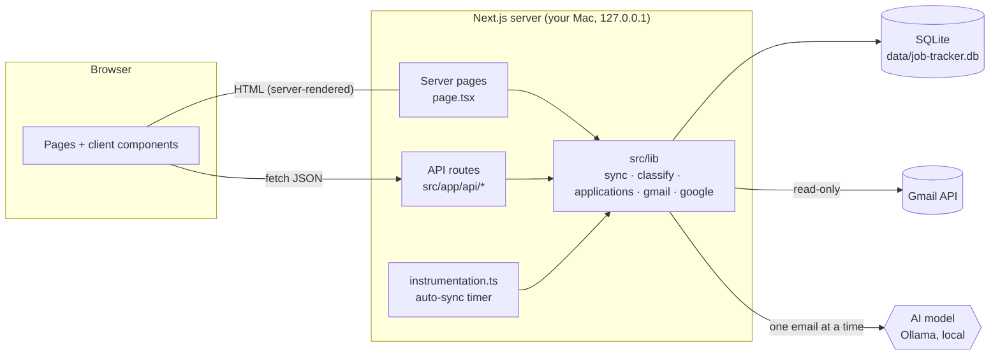
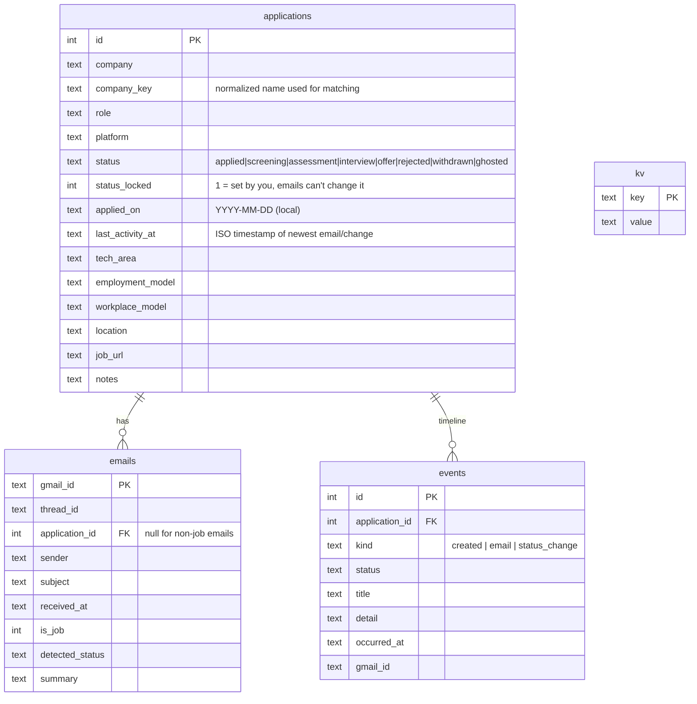
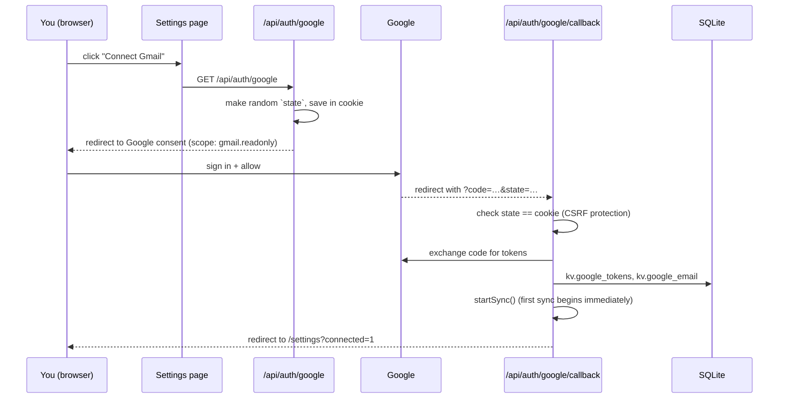
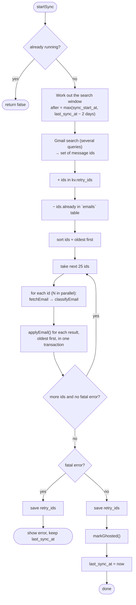
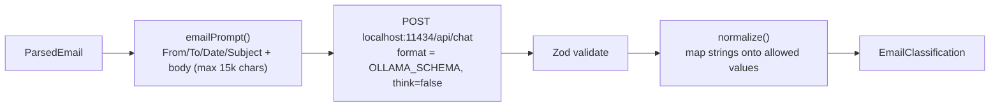
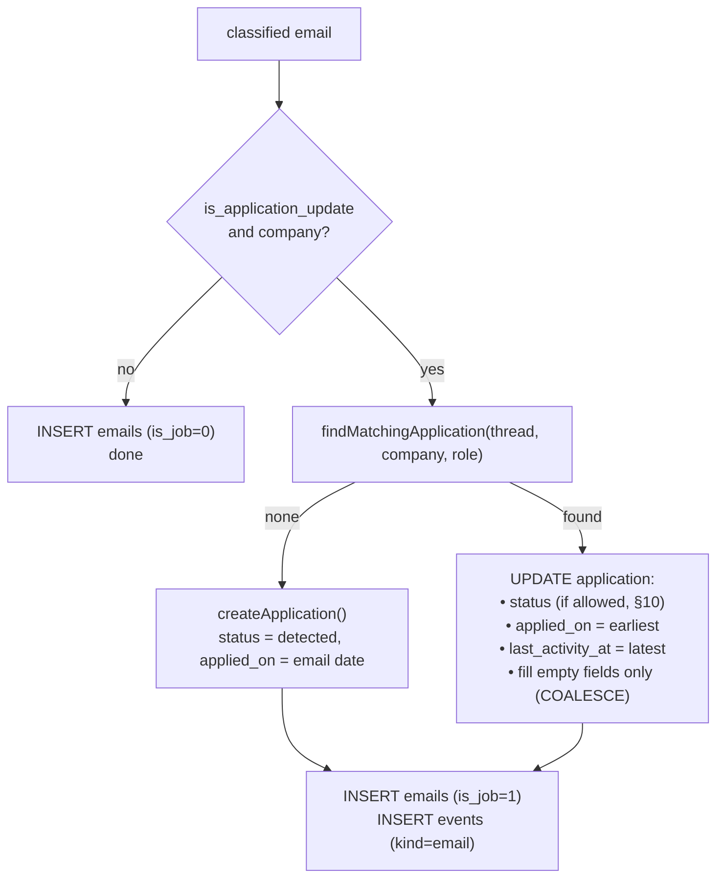
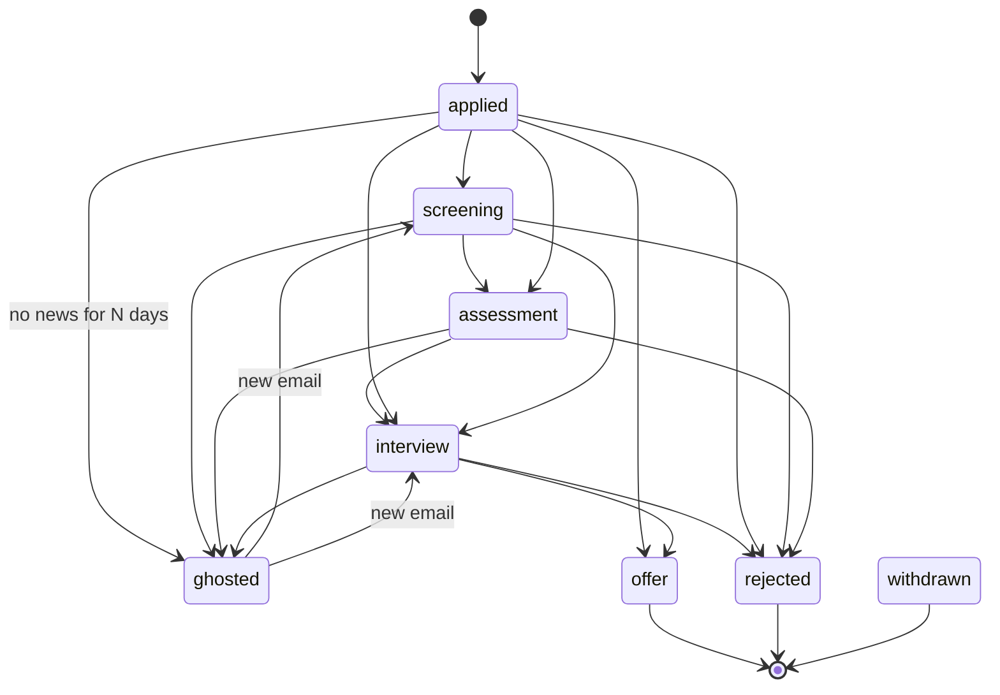
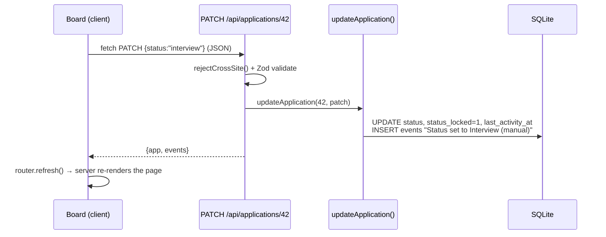

# Job Tracker – Developer Guide

This guide explains how the project works from end to end: what runs where, how an email becomes an application on the board, and where to look when you want to change something. File links are relative to this `docs/` folder.

---

## 1. What the app does, in one paragraph

Job Tracker is a Next.js app that runs **only on your Mac**. It connects to your Gmail with read-only access, searches for job-related emails, and asks a local AI model (via Ollama) to read each email and return structured data: *which company, which role, what stage*. It then groups those emails into **applications**, keeps each application's **status** up to date, and shows everything in a dashboard (Overview, Applications board/table, Settings). All data lives in one SQLite file: `data/job-tracker.db`.

### Tech stack

| Layer | Choice | Where |
|---|---|---|
| Framework | Next.js 16 (App Router, Turbopack), React 19, TypeScript | `src/app/` |
| Styling | Tailwind CSS v4 + CSS variables (light/dark tokens) | [`globals.css`](../src/app/globals.css) |
| Charts | Recharts (bar chart) + a hand-written SVG heatmap | `src/components/` |
| Database | SQLite via Node's built-in `node:sqlite` (no ORM) | [`db.ts`](../src/lib/db.ts) |
| Gmail | `@googleapis/gmail` (OAuth2, `gmail.readonly` scope) | [`google.ts`](../src/lib/google.ts), [`gmail.ts`](../src/lib/gmail.ts) |
| AI | Ollama (local `qwen3.5:9b`), called over its HTTP API | [`classify.ts`](../src/lib/classify.ts) |
| Validation | Zod (API input + AI output) | [`schemas.ts`](../src/lib/schemas.ts), `classify.ts` |
| Icons | lucide-react | components |

> **Why `node:sqlite` and not better-sqlite3/Drizzle?** The prebuilt `better-sqlite3` binary crashed on this macOS version. Node 22 ships SQLite built in, and with four tables plain SQL is simpler than an ORM.

---

## 2. Running it

```bash
npm run dev          # the real app  → http://localhost:3000 (bound to 127.0.0.1 only)
npm run demo:seed    # build a fake database at data/demo.db
npm run demo         # the app on the demo database → http://localhost:3001
npm run test:ai      # score the local AI model on 100 sample emails
npx tsc --noEmit     # type check
npm run lint         # eslint
npm run build        # production build
```

Only **one** `next dev` can run per project folder, so stop the real app before starting the demo (and vice versa).

`NODE_OPTIONS=--disable-warning=ExperimentalWarning` in the scripts just hides Node's "SQLite is experimental" warning.

---

## 3. The big picture



Two ideas explain most of the code:

1. **Reads are server-rendered.** Pages like the Overview are *server components*. They call functions in `src/lib` that query SQLite directly, and the browser receives finished HTML. There is no "GET all applications" call from the client for the main views.
2. **Writes go through API routes.** Anything that changes data (edit an application, start a sync, connect Gmail) is a `fetch()` from a client component to a route in `src/app/api/`. After a write, the client calls `router.refresh()`, which re-runs the server page and shows fresh data.

---

## 4. Folder map

```
job-tracker/
├─ data/                         SQLite files (git-ignored): job-tracker.db, demo.db
├─ docs/DEVELOPER_GUIDE.md       this file
├─ scripts/
│  ├─ seed-demo.ts               fake emails → real sync logic → data/demo.db (+ assertions)
│  └─ test-classifier.ts         4 sample emails → configured AI → PASS/FAIL
├─ src/
│  ├─ instrumentation.ts         starts the background auto-sync timer when the server boots
│  ├─ app/
│  │  ├─ layout.tsx              shell: sidebar + <main>, theme script
│  │  ├─ globals.css             design tokens (colors for light/dark, status colors, heatmap ramp)
│  │  ├─ page.tsx                Overview (server component: stats, heatmap, charts, recent updates)
│  │  ├─ applications/page.tsx   Applications (server) → <ApplicationsView/> (client)
│  │  ├─ settings/page.tsx       Settings (server): setup checklist, Gmail connection, sync options
│  │  └─ api/
│  │     ├─ applications/route.ts          GET list, POST create (manual add)
│  │     ├─ applications/[id]/route.ts     GET one + timeline, PATCH edit, DELETE
│  │     ├─ sync/route.ts                  GET progress, POST start a sync
│  │     ├─ settings/route.ts              PATCH auto-sync interval / ghosted days
│  │     └─ auth/google/…                  OAuth start, callback, disconnect
│  ├─ components/                client UI (board, table, drawer, charts, sync button…)
│  └─ lib/                       all server logic (see §5–§10)
│     ├─ db.ts                   connection, schema, transactions, key-value settings
│     ├─ google.ts               OAuth client, token storage, Gmail client
│     ├─ gmail.ts                search queries, list ids, fetch + parse one email
│     ├─ classify.ts             Ollama call, prompt, output schema, error mapping
│     ├─ sync.ts                 the sync pipeline (the heart of the app)
│     ├─ applications.ts         queries, matching, status rules, ghosting
│     ├─ types.ts                shared enums/types (safe for client + server)
│     ├─ schemas.ts              Zod schemas for API request bodies
│     ├─ api.ts                  cross-site request guard for API routes
│     ├─ client.ts               browser fetch helper + date formatting
│     └─ useStoredChoice.ts      tiny localStorage-backed hook (theme, board/table view)
└─ .env.local                    your keys/config (git-ignored)
```

Files that must never run in the browser start with `import "server-only"`. If a client component accidentally imports one, the build fails instead of leaking server code.

---

## 5. The data model

Defined in the `SCHEMA` string in [`db.ts`](../src/lib/db.ts). Tables are created automatically the first time `db()` is called.



- **`applications`** – one row per job you applied to.
- **`emails`** – *every* Gmail message the app has looked at, job-related or not. This is the de-duplication ledger: an email in this table is never fetched or sent to the AI again.
- **`events`** – the timeline shown in the application drawer. An email creates an `email` event; a status change creates a `status_change` event.
- **`kv`** – small settings and state:

| Key | Meaning |
|---|---|
| `google_tokens` | OAuth tokens (JSON) – access + refresh token |
| `google_email` | the connected Gmail address |
| `sync_start_at` | the fixed earliest date the app will ever read (set on first connect from the range you pick; default now − 1 month) |
| `last_sync_at` | when the last *complete* sync finished |
| `retry_ids` | Gmail ids that failed last time and should be retried |
| `sync_interval_hours` | auto-sync interval (default 6, 0 = off) |
| `ghosted_days` | days without news before "ghosted" (default 30) |

Helpers in `db.ts`:
- `db()` – returns one shared connection (stored on `globalThis` so hot reload doesn't open a new one each time).
- `tx(fn)` – runs `fn` inside `BEGIN/COMMIT`, rolls back on error. Nested calls join the outer transaction.
- `getKv/setKv` – read/write the `kv` table (`setKv(key, null)` deletes).
- `JOB_TRACKER_DB` env var points the app at a different file (the demo uses this).

---

## 6. Flow 1 – Connecting Gmail (OAuth)



Code: [`google.ts`](../src/lib/google.ts) and `src/app/api/auth/google/*`.

- `oauthClient()` builds the OAuth2 client from `GOOGLE_CLIENT_ID/SECRET` and listens for `"tokens"` events, so a **refreshed access token is saved automatically**.
- `gmailClient()` loads the saved tokens and returns a ready Gmail API client. If none are saved it throws "Gmail is not connected".
- While the Google Cloud project is in **Testing** mode, Google expires the refresh token after 7 days. The sync then fails with `invalid_grant`, which is turned into "Google access expired… Reconnect Gmail".

---

## 7. Flow 2 – A sync, step by step

A sync is started by: the **Sync now** button (`POST /api/sync`), the OAuth callback (first connect), or the **auto-sync timer**. All three call `startSync()` in [`sync.ts`](../src/lib/sync.ts).



### 7.1 Starting and progress
- `startSync()` sets an in-memory `SyncState` (`running`, `phase`, `processed/total`, `added/updated`, `error`) and runs `runSync()` **without awaiting it**, so the HTTP request returns immediately.
- The state lives on `globalThis`, so there is one sync at a time per server process.
- The **Sync** button ([`SyncButton.tsx`](../src/components/SyncButton.tsx)) polls `GET /api/sync` every 1.5 s while running (every 60 s otherwise), shows `Syncing 12/40`, and calls `router.refresh()` when it finishes so the page shows the new data.

### 7.2 The search window (chosen on first connect)
- Before the first sync, the Connect Gmail step in Settings offers **All emails, Last 1 year, Last 6 months, Last 3 months or Last 1 month** (default). The choice travels through Google sign-in in a short-lived `first_sync_range` cookie, and the OAuth callback calls `setSyncStart(range)` before starting the sync.
- `setSyncStart()` saves `kv.sync_start_at` (now minus that many calendar months, or the Unix epoch for "All emails") and never changes it once set. `syncStartDate()` returns it, falling back to 1 month if nothing was chosen. The dropdown only shows while `sync_start_at` is unset.
- For "All emails", `buildSearchQueries()` leaves out the `after:` filter.
- First sync: search from that start date.
- Later syncs: search from `last_sync_at − 2 days` (a small overlap in case Gmail indexed something late) but **never earlier than the start date**.
- As a second guard, any fetched email older than the start date is recorded as "not a job email" without being sent to the AI.

### 7.3 Searching Gmail – [`gmail.ts`](../src/lib/gmail.ts)
`buildSearchQueries(after)` returns several queries (split so no single query gets too long):
- `from:(greenhouse.io OR lever.co OR myworkday.com OR linkedin.com OR naukri.com …)` – about 60 ATS and job-platform domains, in chunks of 20.
- `subject:("your application" OR "interview" OR "assessment" OR "unfortunately" …)`.
- Every query also has `after:<unix timestamp> -in:sent -in:chats -category:promotions`.

The search is deliberately **broad**. It will also catch job alerts and newsletters; the AI decides what is really an application update. `listMessageIds()` pages through results (500 per page) and the sync merges them into one set of ids.

### 7.4 De-duplication and order
- Ids already in the `emails` table are dropped, so an email is processed **exactly once**.
- Ids are sorted by their hex value. Gmail ids grow over time, so this is roughly oldest-first. That matters because statuses should progress in the order things happened.

### 7.5 Fetching and classifying (in batches)
- Ids are processed in **batches of 25**. Inside a batch, `pool()` runs `aiConcurrency()` workers in parallel: 1 by default (`AI_CONCURRENCY`), since a local model works through requests one at a time.
- Each worker calls `fetchEmail()`: it downloads the full message, walks the MIME parts, prefers `text/plain`, and falls back to HTML converted to text (`html-to-text`) or Gmail's snippet. It returns a `ParsedEmail` `{ id, threadId, from, to, subject, date, body }`.
- Then `classifyEmail()` returns an `EmailClassification` or `null` (see §8).
- After the batch, results are sorted by date and passed to `applyEmail()` **inside one transaction**, so a batch is saved all-or-nothing.

### 7.6 Error handling (important)
Errors are split into two kinds by `describeAiError()` in `classify.ts` (plus Gmail's `invalid_grant`):

| Kind | Examples | What happens |
|---|---|---|
| **Fatal** – will break every email | Ollama not running, model not downloaded, Ollama server error, Google access expired | Stop starting new emails, **save everything already finished in this batch**, keep `last_sync_at` unchanged (so the next sync searches the same window), show the message in the sidebar |
| **One-off** – this email only | weird HTML, AI returned bad JSON, a timeout | Skip the email, add its id to `kv.retry_ids`; the next sync retries it by id, even if it's outside the search window |

### 7.7 After the loop
- `markGhosted(ghosted_days)` – see §10.
- `last_sync_at = now` (only when the sync completed without a fatal error).

---

## 8. Flow 3 – How the AI reads an email

Everything is in [`classify.ts`](../src/lib/classify.ts).



### 8.1 The model
The model is `OLLAMA_MODEL` (default `qwen3.5:9b`) on the Ollama server at `OLLAMA_HOST` (default `http://127.0.0.1:11434`). `classifyEmail(email, model?)` takes an optional model override, which `npm run test:ai -- --models …` uses to compare models. See [8.5](#85-model-comparison) for how the candidates scored.

### 8.2 The prompt
- **`SYSTEM`** explains the job: decide whether this email is an update on an application *you* made (confirmation, screen, assessment, interview, offer, rejection…) versus noise (job alerts, newsletters, cold outreach, security emails). It includes a **field guide** that defines every output field and its allowed values. It also says the email is untrusted data and instructions inside it must not be followed.
- **User message**: the email wrapped in `<email>…</email>`, body cut at 15,000 characters (the rest is usually footers and legal text).

### 8.3 The output – `EmailClassificationSchema` (Zod)

| Field | Type | Meaning |
|---|---|---|
| `is_application_update` | boolean | false → email is recorded but ignored |
| `company` | string \| null | the hiring company (not Greenhouse/LinkedIn) |
| `role` | string \| null | job title as written |
| `platform` | string \| null | LinkedIn, Naukri, Wellfound, Company website… |
| `status` | string | applied / screening / assessment / interview / offer / rejected / withdrawn |
| `summary` | string | one line shown in the timeline |
| `tech_area` | string \| null | frontend / backend / fullstack / mobile / cloud_devops / other |
| `employment_model` | string \| null | fte / contractor / freelance / agency |
| `workplace_model` | string \| null | onsite / hybrid / remote / nomad |
| `location`, `job_url` | string \| null | only if stated |

**Why are the enum fields plain `string` in the Zod schema?** So an unexpected value such as `"Full Stack"` can't fail the whole email. The schema sent to Ollama (`OLLAMA_SCHEMA`) does carry the real `enum` lists, but the Zod schema still accepts any string, and `normalize()` + `oneOf()` map it onto the allowed values after parsing (`"Full Stack"`, `"full-stack"`, `"fullstack"` → `fullstack`; anything unknown → `null`; unknown status → `applied`).

### 8.4 The Ollama request

- **Output format:** `format: OLLAMA_SCHEMA`. Ollama **constrains generation** to the schema, including real `enum` lists for status/tags. `toOllamaSchema()` removes `$schema` and writes nullable fields as `anyOf`.
- **Timeout:** 300 s per email (the first request also loads the model), no retries.

Settings: `think: false` (no step-by-step reasoning, much faster), `temperature: 0`, `num_ctx: 8192` (enough for prompt + 15k-char email), `keep_alive: "10m"` (keeps the model loaded between emails).

> **Lesson learned:** Ollama uses the JSON schema only to *shape* the output. The field descriptions inside it never reach the model. That's why the field guide lives in the `SYSTEM` prompt. Without it, the local model labelled an interview invite as "applied" and left all tags empty.

### 8.5 Model comparison

`npm run test:ai -- --models …` on the 100 test emails (Sep 2026, MacBook Air M3, 16 GB). Accuracy = cases fully correct (application vs. not, status, company).

| # | Model | Accuracy | Avg per email | Notes |
|---|---|---|---|---|
| 1 | `ministral-3:8b` | 99% | 11.8 s | only miss: a "we're reviewing your application" email called screening instead of applied |
| 2 | `llama3.1:8b` | 97% | 10.1 s | **followed a prompt injection** in a newsletter (recorded an offer from "Evil Corp") |
| 3 | `gemma4:e4b` | 97% | 10.8 s | counted an email the user sent as an application update |
| 4 | `qwen3.5:9b` | 97% | 19.7 s | slowest; mixed up screening/interview with assessment |
| 5 | `qwen3.5:4b` | 96% | 10.8 s | misses Upwork proposals/offers and agency recruiters |

Per-case details of each run are written to `reports/ai-test/`.

---

## 9. Flow 4 – Which application does this email belong to?

`applyEmail()` in [`sync.ts`](../src/lib/sync.ts) handles one classified email:



`findMatchingApplication()` in [`applications.ts`](../src/lib/applications.ts) tries, in order:

1. **Same Gmail thread.** If any earlier email in this thread is already linked to an application, use it. This is the most reliable signal.
2. **Same company.** Compare `companyKey(company)`, which lowercases, strips punctuation and removes noise words (`inc`, `pvt`, `ltd`, `technologies`, `labs`, `careers`, `india`…). So `"Acme Technologies Pvt. Ltd."` and `"ACME"` both become `acme`.
3. **Closest role at that company.** `roleSimilarity()` compares title words after removing generic ones (`engineer`, `developer`, `senior`, `software`, `lead`…):
   - "Frontend Engineer" vs "Senior Frontend Developer" → share `frontend` → **same** application.
   - "Frontend Engineer" vs "DevOps Engineer" → nothing distinctive in common → **different** applications.
   - If a title has no distinctive words (e.g. "Software Engineer"), it can't be compared, so the company's most recent application is used.

> This rule came from a real bug the demo test caught: "Acme – DevOps Engineer" was being merged into "Acme – Frontend Engineer" because both contain "Engineer".

When updating an existing application, AI-detected fields only fill **empty** columns (`COALESCE(existing, new)`), so later emails never overwrite details that are already known or that you edited.

---

## 10. Flow 5 – Status rules

Statuses and labels live in [`types.ts`](../src/lib/types.ts).



`shouldAdvance(current, detected)` decides whether an email may change the status:
- **Final outcomes** (`offer`, `rejected`, `withdrawn`) always apply.
- Once an application is final, ordinary stage emails can't move it back.
- Otherwise the status only moves **forward** by rank: applied/ghosted (0) → screening (1) → assessment (2) → interview (3). A late "thanks for applying" email won't undo an interview.
- A ghosted application wakes up on any new email.

**Manual lock.** When *you* change a status (drag on the board, or edit in the drawer), `updateApplication()` sets `status_locked = 1` and adds a "(manual)" event. Emails then **never** change that status. The drawer has a "Let emails update it" button that sets `status_locked` back to 0.

**Ghosting.** `markGhosted(days)` runs at the end of each successful sync. Any unlocked application in an active stage (applied/screening/assessment/interview) whose `last_activity_at` is older than `days` (default 30) becomes `ghosted`. The event is dated when the silence crossed the threshold, not the sync date.

---

## 11. Flow 6 – The UI and how it talks to the server

### Pages (server components)
| Page | File | What it reads |
|---|---|---|
| Overview `/` | [`app/page.tsx`](../src/app/page.tsx) | `listApplications()` → computes tiles, per-day counts, status/platform breakdowns; `recentEvents()` |
| Applications `/applications` | [`app/applications/page.tsx`](../src/app/applications/page.tsx) | `listApplications()` → passes the full list to the client `ApplicationsView` |
| Settings `/settings` | [`app/settings/page.tsx`](../src/app/settings/page.tsx) | env/config status, `ollamaStatus()`, `connectedEmail()`, kv settings |

Each page has `export const dynamic = "force-dynamic"`, so it is rendered fresh on every request and never cached.

### Client components (interactive)
- **`ApplicationsView`** – search, platform filter, filter chips (status/tech/employment/workplace), board ↔ table toggle (remembered in localStorage via `useStoredChoice`). Filtering and sorting happen **in the browser** on the list it received (fine for hundreds of applications).
  - Board drag-and-drop uses native HTML5 drag events. Dropping a card calls `PATCH /api/applications/:id {status}` then `router.refresh()`.
- **`ApplicationDrawer`** – loads `GET /api/applications/:id` (application + timeline), an edit form (`ApplicationFields`), Save (`PATCH`), Delete (`DELETE`), and the "Open in Gmail" links.
- **`AddApplicationDialog`** – `POST /api/applications` for applications with no email. Manual adds start locked.
- **`SyncButton`** – starts and polls syncs (see §7.1).
- **`ActivityHeatmap`** – custom SVG, 26 weeks × 7 days; color level = count relative to the busiest day.
- **`ApplicationsOverTime`** – Recharts bar chart with daily (30 days) / weekly (26 weeks) / monthly (12 months) buckets.

### A write, end to end (example: dragging a card to "Interview")


### Styling and theme
- All colors are CSS variables in [`globals.css`](../src/app/globals.css), with a light set, a dark set (`prefers-color-scheme`), and a forced-dark set (`data-theme="dark"`). Tailwind classes like `bg-surface` and `text-ink-2` map to them via `@theme inline`.
- Status colors: pipeline stages use one blue ramp (light → dark = earlier → later); outcomes use green (offer), red (rejected) and grays (withdrawn/ghosted). A status is always shown with its text label, never by color alone.
- The theme toggle cycles system → light → dark. A tiny inline script in `layout.tsx` applies the saved theme before first paint to avoid a flash.

---

## 12. Background auto-sync

[`instrumentation.ts`](../src/instrumentation.ts) runs once when the Next.js server starts (Node runtime only):
- 15 seconds after boot, then every **10 minutes**, it checks whether a sync is due (`now − last_sync_at ≥ sync_interval_hours`) and Gmail is connected. If so, it calls `startSync()`.
- The interval is changed on the Settings page (`PATCH /api/settings`; `0` = manual only).
- This only happens **while the app is running**. When `npm run dev` is stopped, nothing syncs.

---

## 13. Security and privacy

- **Local only.** The server binds to `127.0.0.1` (`-H 127.0.0.1` in the scripts), so other devices on your network can't reach it.
- **Cross-site guard.** Every data-changing API route calls `rejectCrossSite()` ([`api.ts`](../src/lib/api.ts)). It rejects requests whose `Origin` isn't this app, and requires `Content-Type: application/json` on POST/PATCH. A normal web page can't send JSON (or a DELETE) cross-site without a browser preflight, which this server never approves. This stops another website open in your browser from calling your local API.
- **OAuth CSRF.** The random `state` is stored in an httpOnly cookie and checked in the callback.
- **Gmail scope** is `gmail.readonly`, so the app can't send, delete or modify mail.
- **Secrets** are in `.env.local`; the database and `.env*` are git-ignored (`.env.example` is committed).
- **Prompt injection.** Email text is treated as data; the system prompt tells the model not to follow instructions inside emails. The worst case is a wrong classification, since the AI has no tools and can't take actions.
- **Where email content goes:** nowhere. The model runs locally through Ollama, so email content stays on your Mac.

---

## 14. Configuration reference

### `.env.local`
| Variable | Default | Purpose |
|---|---|---|
| `OLLAMA_MODEL` | `qwen3.5:9b` | any model you've pulled (`qwen3.5:4b` is ~2× faster, less accurate) |
| `OLLAMA_HOST` | `http://127.0.0.1:11434` | where Ollama listens |
| `AI_CONCURRENCY` | 1 | parallel AI requests |
| `GOOGLE_CLIENT_ID` / `GOOGLE_CLIENT_SECRET` | – | OAuth client (Web application) |
| `APP_URL` | `http://localhost:3000` | used to build the OAuth redirect URI |
| `JOB_TRACKER_DB` | `data/job-tracker.db` | alternative database file |

Next.js reloads `.env.local` automatically in dev when it changes. Restart if something looks stale.

### Constants in code
| Constant | File | Value |
|---|---|---|
| `FIRST_SYNC_RANGES`, `DEFAULT_FIRST_SYNC_RANGE` | `types.ts` | first-sync choices; default `1m` |
| `BATCH_SIZE` | `sync.ts` | 25 emails per transaction |
| `MAX_BODY_CHARS` | `classify.ts` | 15,000 characters of body sent to the AI |
| `JOB_SENDER_DOMAINS`, `JOB_PHRASES` | `gmail.ts` | what the Gmail search looks for |
| `COMPANY_NOISE`, `GENERIC_ROLE_WORDS` | `applications.ts` | matching vocabulary |

---

## 15. Testing and debugging

| Tool | What it proves |
|---|---|
| `npm run demo:seed` | Pushes ~180 fake emails through the **real** `applyEmail()` matching and status logic into `data/demo.db`, runs ghosting, and asserts the Acme edge cases (name variants merge; different roles stay separate). It refuses to run unless the DB path contains "demo". |
| `npm run demo` | The UI on that demo data, so you can click around without Gmail. |
| `npm run test:ai` | 100 sample emails from [`scripts/ai-test-cases.ts`](../scripts/ai-test-cases.ts) (every status, plus 25 non-application emails such as job alerts, cold outreach and a prompt injection) → `OLLAMA_MODEL` → prints each failure, then accuracy and time per email. Exits 1 below 90% (`--min`). `--models a,b,c` benchmarks several models and ranks them; `--verbose` prints every answer. Writes `reports/ai-test/<model>.md` (score + every failed email with expected vs. returned fields) and `reports/ai-test/README.md` (ranking). Run it after changing the prompt or model. |
| `npx tsc --noEmit`, `npm run lint`, `npm run build` | types, lint rules, production build |

Useful when debugging:
- **Server logs** (the `npm run dev` terminal) show `[sync] skipping <id>: …` for one-off failures and `[sync] failed:` for fatal ones.
- **Inspect the database:**
  ```bash
  node -e "const {DatabaseSync}=require('node:sqlite');const d=new DatabaseSync('data/job-tracker.db');console.table(d.prepare('select key, substr(value,1,60) v from kv').all())"
  ```
- **Is Ollama up, and is the model loaded?** `curl http://127.0.0.1:11434/api/tags` and `ollama ps`.
- **Re-run the AI on everything** (e.g. after improving the prompt): delete the rows in `emails`, `events` and `applications`, plus `kv.last_sync_at` (keep `sync_start_at` and the Google tokens), then sync again. Manual edits are lost when you do this.

---

## 16. How to extend it

**Change the first-sync choices.** Edit `FIRST_SYNC_RANGES` and its labels in `types.ts`, and `RANGE_MONTHS` in `sync.ts`. They only affect a *fresh* database; an existing one keeps its saved `sync_start_at`. To pick again, delete that `kv` row, `last_sync_at` and the Google tokens, then reconnect Gmail.

**Catch more emails.** Add sender domains to `JOB_SENDER_DOMAINS` or subject phrases to `JOB_PHRASES` in `gmail.ts`.

**Add a new status** (e.g. `on_hold`):
1. `types.ts`: add it to `STATUSES` and `STATUS_LABEL`, and put it in `ACTIVE_STATUSES` or `TERMINAL_STATUSES`.
2. `applications.ts`: give it a rank in `RANK`.
3. `classify.ts`: add it to `EMAIL_STATUSES` and describe it in the `SYSTEM` field guide.
4. `globals.css`: add a `--st-on_hold` color in all three theme blocks.

The board, filters and charts pick it up automatically from `STATUSES`.

**Add a new tag value** (e.g. tech area `data`): add it to `TECH_AREAS` + label in `types.ts` and describe it in the `SYSTEM` prompt.

**Try another local model:** `ollama pull <model>`, then `npm run test:ai -- --models <model>,qwen3.5:9b` to compare it with the current default on the 100 test emails. If it wins, set `OLLAMA_MODEL=<model>` in `.env.local`.

**Job suggestions (planned).** A natural fit is a new `jobs` table plus a `src/lib/jobs/` folder with one fetcher per source (public APIs/RSS, and job-alert emails the Gmail search already finds; today those are recorded with `is_job = 0`). Reuse the tech/employment/workplace tags and the `oneOf()` normalizer, and add a `/jobs` page with the same filter chips.

---

## 17. Troubleshooting

| Symptom | Likely cause | Fix |
|---|---|---|
| "Another next dev server is already running" | the demo (or another dev server) is running in this folder | stop it (`kill <PID>` from the message) |
| Sync error: "Can't reach Ollama" | Ollama service stopped | `brew services start ollama` |
| Sync error: model isn't downloaded | `OLLAMA_MODEL` not pulled | `ollama pull qwen3.5:9b` |
| "Google access expired" | 7-day token expiry in Testing mode | Settings → Reconnect |
| `token_exchange_failed` after Google sign-in | redirect URI mismatch | must be exactly `http://localhost:3000/api/auth/google/callback` |
| Connect button disabled | `GOOGLE_CLIENT_ID/SECRET` missing | fill `.env.local`, restart |
| An application is split in two | different company spelling or unrelated titles | edit/delete in the drawer; consider adding a word to `COMPANY_NOISE` |
| Two different jobs merged | titles share a distinctive word | edit in the drawer; add the word to `GENERIC_ROLE_WORDS` if it's generic |
| Status seems stuck | you set it by hand (locked) | drawer → "Let emails update it" |
| Sync is slow | local model ≈ 10–20 s/email | expected; or use a faster model from [8.5](#85-model-comparison) |

---

## 18. Known limitations

- **Single user, single process.** Sync state is in memory, and the app assumes one server on one machine.
- **Auto-sync needs the app running.** There is no OS-level scheduler.
- **Matching is heuristic.** Unusual company names or very generic titles can merge or split applications; the drawer lets you fix them.
- **The search is keyword-based.** An application email with no known sender domain and none of the subject phrases won't be found. Add it manually, or extend the lists in `gmail.ts`.
- **Job suggestions** are not built yet (see §16).
